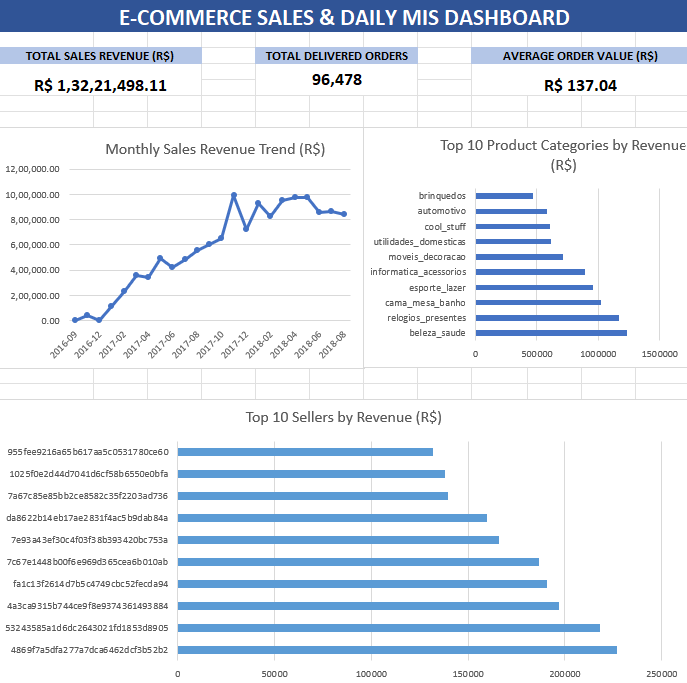
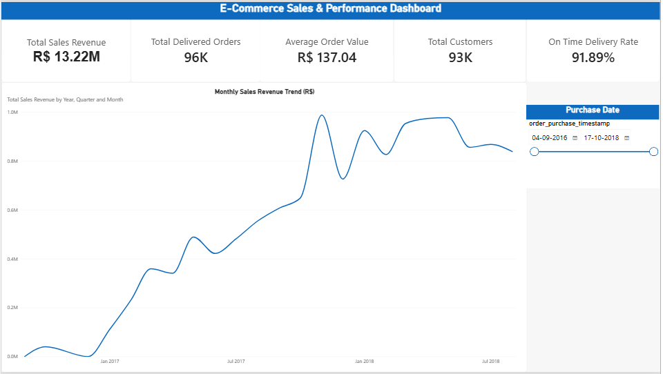
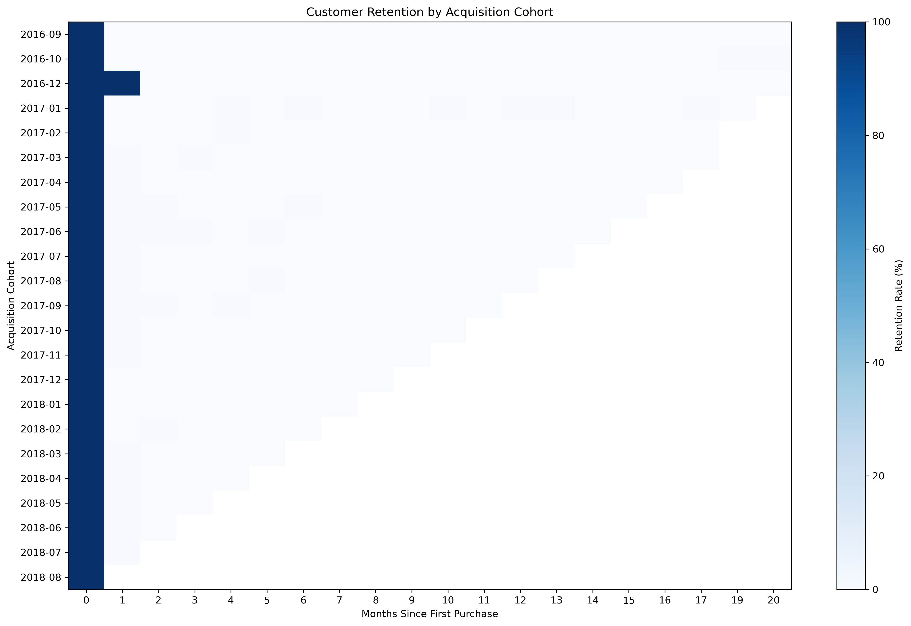

# E-Commerce Business Intelligence & Sales Analytics

**End-to-end Data Analyst portfolio project | Olist Brazilian E-Commerce Dataset**

This repository presents one connected, six-part analysis of historical Brazilian e-commerce data. The workflow moves from data cleaning and quality checks to SQL business analysis, Excel MIS reporting, Power BI dashboards, customer retention analysis, and delivery service-level performance investigation.

## Tools

- **Python:** Jupyter Notebook, pandas, NumPy, Matplotlib
- **SQL:** Microsoft SQL Server / SQL Server Management Studio (SSMS)
- **Excel:** Power Query, PivotTables, charts and KPI reporting
- **Power BI:** Interactive reports, DAX measures and slicers

## Project roadmap

| Part | Analysis | Main deliverables |
|---|---|---|
| 01 | Enterprise Data Cleaning & Quality Audit | `notebooks/01_Enterprise_Data_Cleaning_Beginner.ipynb`, `reports/01_Data_Quality/`, `data_cleaned/` |
| 02 | Advanced SQL Sales & Revenue Analysis | `sql/02_sales_analysis.sql`, `reports/02_SQL_Analysis/`, `insights.md` |
| 03 | Excel Daily MIS Reporting | `excel/03_daily_mis.xlsx`, `excel/refresh_instructions.txt`, `reports/03_Excel_MIS/` |
| 04 | Power BI Executive Sales Dashboard | `powerbi/04_ecommerce_executive_dashboard.pbix`, `reports/04_PowerBI_Dashboard/` |
| 05 | Customer Retention & Cohort Analysis | `notebooks/05_customer_retention_analysis.ipynb`, `sql/05_retention.sql`, `reports/05_Customer_Retention/` |
| 06 | Supply Chain & Delivery SLA Investigation | `sql/06_delivery_sla.sql`, `powerbi/06_delivery_sla.pbix`, `reports/06_Delivery_SLA/` |

## Selected findings

| Metric | Result |
|---|---:|
| All recorded orders | 99,441 |
| Delivered orders | 96,478 |
| Product sales value on delivered orders, excluding freight | R$13,221,498.11 |
| Average product sales value per delivered order | R$137.04 |
| Unique customers with delivered orders | 93,358 |
| Repeat customers | 2,801 (3.00%) |
| Valid deliveries for SLA analysis | 96,470 |
| On-time deliveries | 88,644 (91.89%) |
| Late deliveries | 7,826 (8.11%) |
| Median delivery time | 10.22 days |
| 90th-percentile delivery time | 23.10 days |

**Definitions:** Sales value sums the `price` field of delivered-order items, not freight, payment receipts or profit. Repeat rate is based on unique customers with more than one delivered order. SLA analysis excludes undelivered orders and deliveries without required valid dates. The dataset is historical, and observed relationships do not establish causation.

### Business insights

- **Customer retention:** 2,801 of 93,358 delivered-order customers purchased more than once, suggesting a need to investigate repeat-purchase opportunities.
- **Delivery punctuality:** 8.11% of valid deliveries were late. The March 2018 purchase cohort had a 21.36% late-delivery rate (1,496 of 7,003), warranting further investigation.
- **Geographic variation:** Alagoas (AL) had a 23.93% late rate in the state analysis; sample-size thresholds were applied to avoid overinterpreting very small groups.
- **Customer experience:** Reviewed on-time deliveries averaged 4.29 stars, versus 2.57 for reviewed late deliveries. This is an association, not proof that delays caused the difference.

See `insights.md`, `reports/05_Customer_Retention/05_retention_findings.txt` and `reports/06_Delivery_SLA/root_cause_memo.docx` for detailed analysis and limitations.

## Dashboard previews

**Excel MIS dashboard**



**Power BI executive dashboard**



**Customer cohort heatmap**



The editable `.pbix` files are in `powerbi/`. Open them in Power BI Desktop to explore the interactive pages. The Day 6 delivery SLA report includes a delivery overview and seller/category analysis.

## Repository structure

```text
Ecommerce_Business_Analytics/
├── data_raw/                  # Original Olist CSVs
├── data_cleaned/              # Cleaned analysis-ready CSVs
├── notebooks/                 # Python notebooks (Parts 01 and 05)
├── sql/                       # SQL scripts (Parts 02, 05 and 06)
├── excel/                     # Excel MIS workbook and refresh guide
├── powerbi/                   # Power BI reports (Parts 04 and 06)
├── reports/                   # Outputs organized by project part
├── insights.md                # SQL business insights
└── README.md
```

## How to explore or reproduce

1. Download or clone the repository. The raw data comes from the **Olist Brazilian E-Commerce Public Dataset** on Kaggle: https://www.kaggle.com/datasets/olistbr/brazilian-ecommerce
2. Review `notebooks/01_Enterprise_Data_Cleaning_Beginner.ipynb` to understand cleaning and quality checks. Notebook paths assume the project folder structure shown above.
3. To rerun SQL scripts, load the cleaned CSVs into **Microsoft SQL Server** and configure tables under the `dbo` schema as referenced in the scripts. SQL Server tables are not automatically created by downloading the repository.
4. Open `excel/03_daily_mis.xlsx` in Excel Desktop; review `excel/refresh_instructions.txt` before refreshing external data connections.
5. Open the `.pbix` files in Power BI Desktop. If refreshing data, update any local file paths or connections to your own machine. Saved visuals can be inspected without rerunning the entire pipeline where embedded data is available.
6. Consult the reports folders for supporting tables, charts, the cohort analysis and the delivery root-cause memo.

> **Note:** This is a learning and portfolio project. Data and findings reflect a historical public dataset; targets used in the Excel MIS are illustrative rather than actual company targets.
